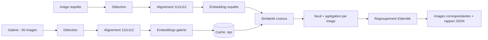

# Architecture du projet

## 1. Vue d'ensemble



## 2. Arborescence du projet

```text
face-recognition-pipeline/
├── README.md
├── requirements.txt
├── pyproject.toml                 # config ruff/black/pytest
├── .gitignore
├── .github/
│   └── copilot-instructions.md
├── configs/
│   └── config.yaml                # modèle, seuils, chemins
├── data/
│   ├── gallery/                   # ~30 images de référence
│   ├── query/                     # image(s) requête
│   ├── labels.csv                 # vérité terrain (filename,person_id)
│   └── cache/                     # embeddings.npz (généré)
├── docs/
│   ├── ROADMAP.md
│   ├── ARCHITECTURE.md
│   └── TECH_STACK.md
├── notebooks/
│   ├── 01_exploration_data.ipynb
│   ├── 02_detection_alignement.ipynb
│   └── 03_analyse_seuils.ipynb
├── src/
│   ├── __init__.py
│   ├── main.py                    # point d'entrée CLI
│   ├── config.py                  # chargement de config.yaml
│   ├── types.py                   # dataclasses : FaceRecord, MatchResult
│   ├── io_utils.py                # lecture images, listing dossier, sauvegarde
│   ├── detection.py               # FaceDetector (détection + landmarks + alignement)
│   ├── embedding.py               # FaceEmbedder (interface + backends)
│   ├── gallery.py                 # indexation de la galerie + cache
│   ├── matching.py                # similarité cosinus, seuil, agrégation par image
│   ├── identity.py                # regroupement d'identité, query expansion
│   ├── pipeline.py                # orchestration bout en bout
│   ├── visualization.py           # boîtes, grilles de résultats, heatmaps
│   └── evaluation.py              # précision / rappel / F1 / ROC
├── app/
│   └── streamlit_app.py           # interface (bonus)
├── tests/
│   ├── test_detection.py
│   ├── test_embedding.py
│   ├── test_matching.py
│   └── test_pipeline.py
├── outputs/                       # résultats générés (ignoré par git)
└── reports/
    └── rapport.md                 # rapport final (méthode, résultats, analyse)
```

## 3. Responsabilités et contrats d'interface

### `types.py`

```python
@dataclass
class FaceRecord:
    image_path: str
    bbox: tuple[int, int, int, int]     # x1, y1, x2, y2
    landmarks: np.ndarray               # (5, 2)
    det_score: float
    aligned: np.ndarray                 # (112, 112, 3) BGR
    embedding: np.ndarray               # (512,) normalisé L2

@dataclass
class MatchResult:
    image_path: str
    best_score: float                   # cosinus max parmi les visages de l'image
    matched_face_index: int
```

### `detection.py`
- `FaceDetector.detect(img) -> list[Face]` : boîtes, 5 points, score.
- `FaceDetector.align(img, landmarks) -> np.ndarray` : crop 112×112 normalisé.
- `select_main_face(faces) -> Face` : choisit le visage de la requête (le plus grand × meilleur score) si plusieurs.

### `embedding.py`
- `class FaceEmbedder(ABC)` avec `embed(aligned_face) -> np.ndarray`.
- `InsightFaceEmbedder` (défaut) et `FacenetEmbedder` (alternative).

### `gallery.py`
- `build_gallery_index(folder) -> list[FaceRecord]` : traite chaque image (plusieurs visages possibles).
- `save_cache / load_cache` : `data/cache/embeddings.npz` (invalidé si les fichiers changent, via hash).

### `matching.py`
- `cosine_similarity_matrix(query_emb, gallery_embs) -> np.ndarray`.
- `match_images(query_emb, records, threshold) -> list[MatchResult]` : agrège par image (max sur ses visages), filtre par seuil, trie par score décroissant.

### `identity.py`
- `expand_query(query_emb, top_matches, k) -> np.ndarray` : moyenne des embeddings les plus sûrs.
- `cluster_gallery(records, distance_threshold) -> labels` : clustering agglomératif cosinus.
- `resolve_identity(query_emb, records, cfg) -> list[MatchResult]` : combine seuil + expansion + cluster pour gérer les **doublons d'identité**.

### `pipeline.py`
- `run(query_path, gallery_dir, output_dir, cfg) -> list[MatchResult]`.

### `evaluation.py`
- `evaluate(results, labels_csv, query_person_id) -> dict` : P, R, F1.
- `sweep_threshold(...)` : courbe P/R/F1 selon le seuil.
- `roc_curve_pairs(...)` : ROC + EER.

## 4. `configs/config.yaml` (exemple)

```yaml
model:
  backend: insightface          # insightface | facenet
  name: buffalo_l
  det_size: [640, 640]
  providers: [CPUExecutionProvider]

detection:
  min_det_score: 0.5
  min_face_size: 40

matching:
  threshold: 0.40               # similarité cosinus
  use_query_expansion: true
  expansion_top_k: 3
  use_gallery_clustering: false
  cluster_distance_threshold: 0.60

paths:
  cache_dir: data/cache
  output_dir: outputs
```

## 5. Format de sortie

`outputs/` contient :

```text
outputs/
├── matches/                       # copies des images correspondantes
├── annotated/                     # images avec boîtes + score
├── result_grid.png                # requête + résultats en grille
└── report.json
```

`report.json` :

```json
{
  "query": "data/query/person.jpg",
  "threshold": 0.40,
  "n_gallery_images": 30,
  "matches": [
    {"image": "gallery/img_03.jpg", "score": 0.71},
    {"image": "gallery/img_17.jpg", "score": 0.58}
  ]
}
```

## 6. Cas limites à gérer

| Cas | Comportement attendu |
|---|---|
| Aucun visage dans la requête | Erreur claire, code retour ≠ 0 |
| Plusieurs visages dans la requête | Visage principal par défaut, option `--face-index` |
| Image de galerie sans visage | Ignorée, avertissement loggé |
| Image de galerie avec plusieurs visages | Une image est retenue si au moins un visage correspond |
| Visage petit, flou ou de profil | Filtrage par `min_det_score` / `min_face_size` |
| Aucun résultat au-dessus du seuil | Retourner liste vide + meilleur score observé |
| Fichier non image / corrompu | Ignoré et loggé |
